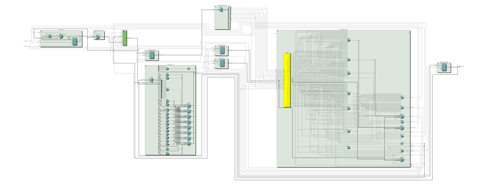
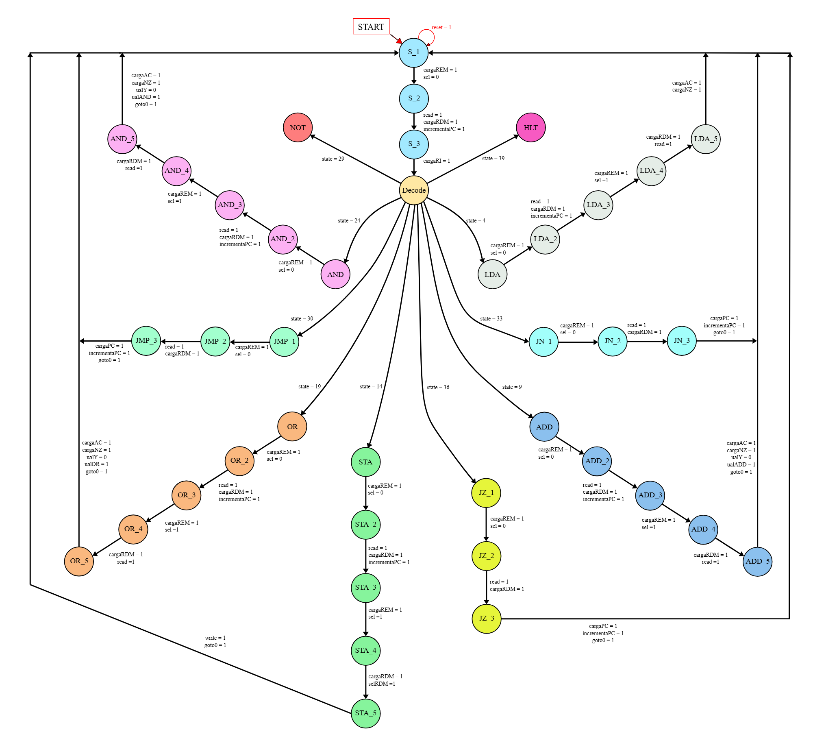
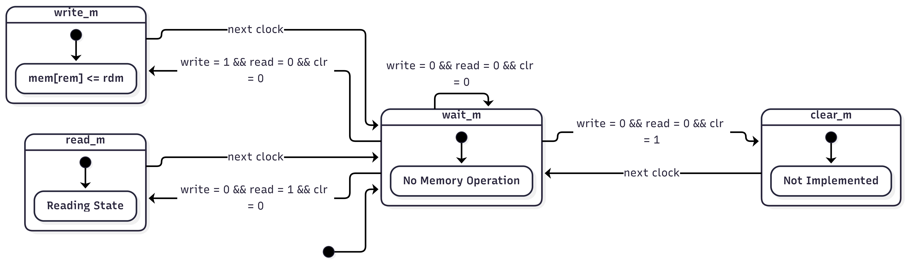

# Neander-CPU

An 8-bit modularized Verilog implementation of the **Neander** CPU architecture, an accumulator-based processor model widely used for computer architecture and hardware design studies.

---

## 📋 Table of Contents
1. [Overview](#-overview)
2. [Repository Structure](#-repository-structure)
3. [Running the Code](#-running-the-code)
4. [Architecture & Datapath](#-architecture--datapath)
5. [Instruction Set Architecture (ISA)](#-instruction-set-architecture-isa)
6. [Finite State Machines (FSM)](#-finite-state-machines-fsm)
   - [1. Control Block FSM](#1-control-block-fsm)
   - [2. Memory System FSM](#2-memory-system-fsm)
7. [Submodule Breakdown](#-submodule-breakdown)
8. [Simulation & Waveforms](#-simulation--waveforms)

---

## 🔍 Overview

The Neander architecture is a classic 8-bit accumulator-based computer model. This repository contains Verilog HDL design files implementing the CPU datapath, instruction decoding, control unit state machines, memory subsystem, and testbenches.

Key characteristics:
- **Data & Address Width**: 8-bit data bus and 8-bit memory address space (256 bytes memory capacity).
- **Architecture Type**: Accumulator-based CPU, Von-Neumman.
- **Condition Flags**: `N` (Negative) and `Z` (Zero).
- **Execution Scheme**: Micro-sequenced Finite State Machine controlling instruction fetch, decode, and execution cycles.

---

## 📁 Repository Structure

```
.
├── rtl/                            # One Verilog file per module
│   ├── neader_core.v               # Top-level datapath and control connections
│   ├── control_block.v             # Central Control Unit FSM
│   ├── mem_sis.v                   # 256-byte RAM Memory Subsystem FSM
│   ├── alu.v                       # 8-bit Arithmetic Logic Unit
│   ├── pc.v                        # Program Counter (8-bit)
│   ├── decoder.v                   # Instruction Opcode Decoder
│   ├── multiplexer_8bits.v          # 8-bit 2-to-1 Multiplexer
│   ├── d_flip_flop_main.v          # N-bit Register / Flip-Flop
│   ├── d_flip_flop.v               # Single-bit Flip-Flop
│   ├── counter.v                   # 3-bit Counter
│   └── temporization_architecture.v # Timing signal generator
├── testbenches/
│   ├── testbenchmain.v             # Basic CPU testbench
│   └── individual_programs_tb.v    # Six individual tests plus the original program
├── mem/                            # Testbench-loaded memory initialization files
│   ├── prog_sum1.mem
│   ├── prog_sum2.mem
│   ├── prog_logic1.mem
│   ├── prog_logic2.mem
│   ├── prog_jump1.mem
│   ├── prog_jump2.mem
│   └── prog_original.mem
├── sim/
│   └── run_verification.sh         # Runs seven programs; outputs in sim/build/
├── previous_impl/
│   ├── neander/
│   │   ├── All_Together.v          # Original combined CPU implementation
│   │   └── testbenchmain.v         # Matching original CPU testbench
│   └── memory_system/
│       ├── mem_sis.v              # Standalone memory subsystem copy
│       └── mem_sis_tb.v           # Memory write/reset/readback testbench
├── images/                         # Architecture and FSM diagrams
└── README.md
```

---

## ▶️ Running the Code

The primary verification workflow compiles the **multi-file** implementation from `rtl/` using Verilog-2005. The `individual_programs_tb` testbench runs seven independent memory images sequentially, resetting the CPU between programs and printing PASS or FAIL for each test:

```bash
bash sim/run_verification.sh
```

Run these commands from the repository root in Linux or WSL. Requires Bash and Icarus Verilog (`iverilog` and `vvp`); GTKWave is optional for viewing waveforms. The executable, compile log, simulation log, and VCD file are generated under `sim/build/`.

```bash
gtkwave sim/build/individual_programs.vcd
```

Tests 1-2 verify sums, 3-4 logic, and 5-6 two separate conditional structures (JZ and JN). Test 7 runs the original complete program. RAM has no program initialization in `rtl/mem_sis.v`; the testbenches load the `.mem` files using `$readmemh`. Each memory file contains all 256 RAM bytes, preventing data from the previous test from carrying over. The six short programs have 100 clock cycles each; the original program has 150. After each execution window, the bench checks the accumulator, program counter, flags, stored result, and HLT state. One VCD file contains all seven tests. The runner returns a failure if the final success message is missing.

To run the basic CPU testbench:

```bash
iverilog -g2005 -s tb_Main -o /tmp/neander.vvp rtl/*.v testbenches/testbenchmain.v
vvp /tmp/neander.vvp
```

The basic bench loads `mem/prog_original.mem` and runs the original program, prints observations, and generates a waveform. The seven-program bench above provides automated result checks.

To run the preserved original CPU and the standalone memory testbench:

```bash
iverilog -g2005 -s tb_Main -o /tmp/neander_legacy.vvp previous_impl/neander/All_Together.v previous_impl/neander/testbenchmain.v
vvp /tmp/neander_legacy.vvp

iverilog -g2005 -s mem_sis_tb -o /tmp/neander_memory_tb.vvp previous_impl/memory_system/mem_sis.v previous_impl/memory_system/mem_sis_tb.v
vvp /tmp/neander_memory_tb.vvp
```

Compile the original combined CPU separately: it already contains its submodules. The memory bench checks that a byte written to RAM can be read back after a register reset.


---

## 🏗️ Architecture & Datapath

The Neander CPU consists of the following key functional units:

- **Program Counter (PC)**: 8-bit register holding the memory address of the next instruction/operand to be fetched.
- **Accumulator (AC)**: 8-bit register storing intermediate data and arithmetic/logic results.
- **Instruction Register (RI)**: 8-bit register storing the opcode of the currently executing instruction.
- **Memory Address Register (REM)**: 8-bit register holding addresses directed to the RAM.
- **Memory Data Register (RDM)**: 8-bit register buffering data read from or written to RAM.
- **Arithmetic Logic Unit (ALU)**: Executes operations on AC and RDM outputs (`ADD`, `OR`, `AND`, `NOT`, and pass-through `Y`), updating `N` and `Z` flags.
- **Instruction Decoder**: Decodes the 4 most significant bits (`Op[7:4]`) of RI into instruction control lines.
- **Multiplexer (MUX)**: Selects between PC and memory data outputs to feed into REM.

  Representation of Implemented Architecture:
  

  For more details check the images/Architecture_Modules.pdf

---

## 📜 Instruction Set Architecture (ISA)

The Neander processor utilizes 4-bit opcodes (`Op[7:4]`):

| Instruction | Opcode (Hex) | Opcode (Binary) | Description |
| :--- | :---: | :---: | :--- |
| **NOP** | `0x0` | `0000` | No Operation |
| **STA** | `0x1` | `0001` | Store AC content into memory address |
| **LDA** | `0x2` | `0010` | Load AC with content from memory address |
| **ADD** | `0x3` | `0011` | Add memory content to AC (`AC <- AC + M[addr]`) |
| **OR**  | `0x4` | `0100` | Bitwise OR memory content with AC (`AC <- AC \| M[addr]`) |
| **AND** | `0x5` | `0101` | Bitwise AND memory content with AC (`AC <- AC & M[addr]`) |
| **NOT** | `0x6` | `0110` | Bitwise NOT on AC (`AC <- ~AC`) |
| **JMP** | `0x8` | `1000` | Unconditional Jump to address |
| **JN**  | `0x9` | `1001` | Jump if Negative flag (`N = 1`) |
| **JZ**  | `0xA` | `1010` | Jump if Zero flag (`Z = 1`) |
| **HLT** | `0xF` | `1111` | Halt instruction execution |

---

## 🔄 Finite State Machines (FSM)

The system relies on two key Finite State Machines:

### 1. Control Block FSM
The Control Block FSM (`control_block.v`) manages instruction fetch (`search1` -> `search2` -> `search3`), instruction decoding (`decode_state`), and execution sequences for each instruction in the ISA.


#### State descriptions and control signals

The following tables describe the implementation in `rtl/control_block.v`. State numbers are decimal. `M[REM]` means the RAM byte at the address held in REM. Transfers describe the rising edge ending the current CPU state, except that a RAM write request is completed by the separate memory FSM as explained below. These are sequential execution phases, not pipeline stages.

By default, all control outputs are zero except `UALy=1`, which selects the ALU's RDM pass-through. The tables list asserted controls and selector overrides. `sel=0` routes PC to REM; `sel=1` routes RDM to REM. `selRDM=0` selects RAM data for RDM; `selRDM=1` selects AC. An ALU operation other than pass-through also sets `UALy=0`.

`carga_NZ=1` saves N (result bit 7) and Z (result equals zero). Only LDA, ADD, OR, AND and NOT update these flags. `incrementa_PC` is also the PC enable: with `carga_PC=0` it increments PC; with `carga_PC=1` it loads RDM instead. `gotot0` is asserted in some completion states but is not used to drive the FSM; `next_state` selects the next state. `selREM` remains zero and is unused by the top level.

| State (decimal ID) | Transfer or purpose | Active controls / overrides | Next state |
| :--- | :--- | :--- | :--- |
| `search1` (0) | REM <- PC: address the instruction | `cargaREM=1`, `sel=0` | `search2` |
| `search2` (1) | RDM <- M[REM]; PC <- PC+1 | `read=1`, `cargaRDM=1`, `incrementa_PC=1` | `search3` |
| `search3` (2) | RI <- RDM | `cargaRI=1` | `decode_state` |
| `decode_state` (3) | Decode RI[7:4]; no register load | Defaults | First state for the decoded instruction; NOP or unsupported opcode -> `search1`; HLT -> `state_HLT` |

**LDA, ADD, OR and AND: operand fetch and execution**

Each instruction first reads the address byte following its opcode, then reads the operand at that address. ADD keeps the low eight result bits; no carry flag is stored.

| State (decimal ID) | Transfer or purpose | Active controls / overrides | Next state |
| :--- | :--- | :--- | :--- |
| `state_LDA` (4) | REM <- PC | `cargaREM=1`, `sel=0` | `state_LDA2` |
| `state_LDA2` (5) | RDM <- M[REM]; PC <- PC+1 | `read=1`, `cargaRDM=1`, `incrementa_PC=1` | `state_LDA3` |
| `state_LDA3` (6) | REM <- RDM: select operand address | `cargaREM=1`, `sel=1` | `state_LDA4` |
| `state_LDA4` (7) | RDM <- M[REM]: read operand | `read=1`, `cargaRDM=1` | `state_LDA5` |
| `state_LDA5` (8) | AC <- RDM; update N/Z | `carga_AC=1`, `carga_NZ=1` | `search1` |
| `state_ADD` (9) | REM <- PC | `cargaREM=1`, `sel=0` | `state_ADD2` |
| `state_ADD2` (10) | RDM <- M[REM]; PC <- PC+1 | `read=1`, `cargaRDM=1`, `incrementa_PC=1` | `state_ADD3` |
| `state_ADD3` (11) | REM <- RDM | `cargaREM=1`, `sel=1` | `state_ADD4` |
| `state_ADD4` (12) | RDM <- M[REM] | `read=1`, `cargaRDM=1` | `state_ADD5` |
| `state_ADD5` (13) | AC <- AC + RDM; update N/Z | `carga_AC=1`, `carga_NZ=1`, `UALy=0`, `UALadd=1`, `gotot0=1` | `search1` |
| `state_OR` (19) | REM <- PC | `cargaREM=1`, `sel=0` | `state_OR2` |
| `state_OR2` (20) | RDM <- M[REM]; PC <- PC+1 | `read=1`, `cargaRDM=1`, `incrementa_PC=1` | `state_OR3` |
| `state_OR3` (21) | REM <- RDM | `cargaREM=1`, `sel=1` | `state_OR4` |
| `state_OR4` (22) | RDM <- M[REM] | `read=1`, `cargaRDM=1` | `state_OR5` |
| `state_OR5` (23) | AC <- AC OR RDM; update N/Z | `carga_AC=1`, `carga_NZ=1`, `UALy=0`, `UALor=1`, `gotot0=1` | `search1` |
| `state_AND` (24) | REM <- PC | `cargaREM=1`, `sel=0` | `state_AND2` |
| `state_AND2` (25) | RDM <- M[REM]; PC <- PC+1 | `read=1`, `cargaRDM=1`, `incrementa_PC=1` | `state_AND3` |
| `state_AND3` (26) | REM <- RDM | `cargaREM=1`, `sel=1` | `state_AND4` |
| `state_AND4` (27) | RDM <- M[REM] | `read=1`, `cargaRDM=1` | `state_AND5` |
| `state_AND5` (28) | AC <- AC AND RDM; update N/Z | `carga_AC=1`, `carga_NZ=1`, `UALy=0`, `UALand=1`, `gotot0=1` | `search1` |

**STA and NOT**

| State (decimal ID) | Transfer or purpose | Active controls / overrides | Next state |
| :--- | :--- | :--- | :--- |
| `state_STA` (14) | REM <- PC | `cargaREM=1`, `sel=0` | `state_STA2` |
| `state_STA2` (15) | RDM <- M[REM]; PC <- PC+1 | `read=1`, `cargaRDM=1`, `incrementa_PC=1` | `state_STA3` |
| `state_STA3` (16) | REM <- RDM: select destination | `cargaREM=1`, `sel=1` | `state_STA4` |
| `state_STA4` (17) | RDM <- AC | `cargaRDM=1`, `selRDM=1` | `state_STA5` |
| `state_STA5` (18) | Request M[REM] <- RDM | `write=1`, `gotot0=1` | `search1` |
| `state_NOT` (29) | AC <- NOT AC; update N/Z | `carga_AC=1`, `carga_NZ=1`, `UALy=0`, `UALnot=1`, `gotot0=1` | `search1` |

The memory FSM enters `write_m` at the edge ending `state_STA5`. RAM is actually written at the following rising edge, while the CPU is in `search1`. The write uses the previous REM value even though that same edge loads REM with PC, because the registers use nonblocking assignments.

**Jumps, NOP and HLT**

After instruction fetch, PC points to the jump's target-address byte. A taken jump reads that byte into RDM and loads PC. An untaken conditional jump increments PC once to skip that byte. The control input `SZ` is connected to the stored Z flag.

| State (decimal ID) | Transfer or purpose | Active controls / overrides | Next state |
| :--- | :--- | :--- | :--- |
| `state_JMP` (30) | REM <- PC | `cargaREM=1`, `sel=0` | `state_JMP2` |
| `state_JMP2` (31) | RDM <- M[REM]: read target address | `read=1`, `cargaRDM=1` | `state_JMP3` |
| `state_JMP3` (32) | PC <- RDM | `carga_PC=1`, `incrementa_PC=1`, `gotot0=1` | `search1` |
| `state_JN` (33), N=1 | REM <- PC | `cargaREM=1`, `sel=0` | `state_JN2` |
| `state_JN` (33), N=0 | PC <- PC+1: skip target byte | `incrementa_PC=1`, `gotot0=1` | `search1` |
| `state_JN2` (34) | RDM <- M[REM] | `read=1`, `cargaRDM=1` | `state_JN3` |
| `state_JN3` (35) | PC <- RDM | `carga_PC=1`, `incrementa_PC=1`, `gotot0=1` | `search1` |
| `state_JZ` (36), Z=1 | REM <- PC | `cargaREM=1`, `sel=0` | `state_JZ2` |
| `state_JZ` (36), Z=0 | PC <- PC+1: skip target byte | `incrementa_PC=1`, `gotot0=1` | `search1` |
| `state_JZ2` (37) | RDM <- M[REM] | `read=1`, `cargaRDM=1` | `state_JZ3` |
| `state_JZ3` (38) | PC <- RDM | `carga_PC=1`, `incrementa_PC=1`, `gotot0=1` | `search1` |
| `state_HLT` (39) | Hold execution state; no register load or memory request | Defaults | `state_HLT` |

NOP has no extra execution state: `decode_state` returns directly to `search1`. HLT loops until reset. Asserting `rst` asynchronously sets the control state to `search1`; the top-level reset also clears PC, AC, RI, flags and memory registers, preserving RAM. An unrecognized control-state encoding returns to `search1` with default outputs.

The existing illustration below has known omissions; the tables above describe the current RTL, including both conditional-branch paths and the correct STA sequence.



---

### 2. Memory System FSM
The Memory System FSM (`mem_sis.v`) handles RAM access synchronization and memory operations (`wait_m`, `read_m`, `write_m`, and `clear_m`).


#### Memory state descriptions

The memory FSM has its own state register. These encodings are binary, independent of the CPU control-state numbers above.

| State | Behavior | Next state |
| :--- | :--- | :--- |
| `wait_m` (`00`) | No RAM write. Examine `write`, `read` and `clr`. | Only write asserted -> `write_m`; only read asserted -> `read_m`; only clr asserted -> `clear_m`; otherwise stay in `wait_m` |
| `write_m` (`01`) | At the rising edge, RAM[REM] <- RDM. | `wait_m` |
| `read_m` (`10`) | Read-cycle state; does not itself enable RDM. | `wait_m` |
| `clear_m` (`11`) | Reserved state; RAM clearing is not implemented. | `wait_m` |

RAM reads feed a combinational mux continuously. Whenever `rdm_e=1`, RDM captures either RAM[REM] (`mux_sel1=0`) or AC (`mux_sel1=1`) at the rising edge, independently of the memory FSM state. Likewise `rem_e=1` enables REM loading. Reset sets the memory FSM to `wait_m` and clears REM/RDM without clearing RAM. The CPU ties `clr` to zero, so normal execution does not use `clear_m`.




---

## ⚙️ Submodule Breakdown

- **`neader_core.v`**: Top-level module wiring `pc`, `AC`, `RI`, `alu`, `control_block`, `decoder`, `multiplexer_8bits`, and `mem_sis`.
- **`control_block.v`**: FSM emitting control signals (`cargaRI`, `selRDM`, `carga_AC`, `carga_NZ`, `carga_PC`, `incrementa_PC`, `cargaREM`, `sel`, `write`, `read`, ALU operation triggers).
- **`mem_sis.v`**: 256x8-bit memory array with FSM control for synchronized read and write operations.
- **`alu.v`**: Performs arithmetic and logical operations, setting status bits `n` (sign bit) and `z` (zero check).
- **`pc.v`**: 8-bit counter supporting sequential increment and direct load operations for jumps.
- **`decoder.v`**: 4-to-16 instruction opcode decoder.

---

## 🧪 Simulation & Waveforms

The verification runner generates VCD waveforms under `sim/build/` for verifying design behavior:
- Run testbenches using Verilog simulators like Icarus Verilog (`iverilog`) or ModelSim.
- View generated `.vcd` files (e.g., `sim/build/individual_programs.vcd`) using **GTKWave**.

### Testbench programs

`testbenches/individual_programs_tb.v` runs the following seven programs. All addresses and data values below are hexadecimal. Every test checks the final accumulator (AC), program counter (PC), flags (N/Z), selected RAM result, and HLT state.

| Test | Memory file | Operation | Final AC | Checked RAM | Final PC | N/Z |
| :---: | :--- | :--- | :---: | :--- | :---: | :---: |
| 1 | `prog_sum1.mem` | A5 + 05 | AA | `[82] = AA` | 07 | 1/0 |
| 2 | `prog_sum2.mem` | AA + 05 | AF | `[82] = AF` | 07 | 1/0 |
| 3 | `prog_logic1.mem` | (AA OR 55) AND 0F | 0F | `[83] = 0F` | 09 | 0/0 |
| 4 | `prog_logic2.mem` | NOT 0F | F0 | `[82] = F0` | 06 | 1/0 |
| 5 | `prog_jump1.mem` | JZ skips an early halt | A5 | `[82] = A5` | 0A | 1/0 |
| 6 | `prog_jump2.mem` | JN skips an early halt | A5 | `[82] = A5` | 08 | 1/0 |
| 7 | `prog_original.mem` | Original complete program | AF | `[82] = AA` | 21 | 1/0 |

**Tests 1 and 2: additions**

Both programs use the same instruction sequence, with different initial data:

```text
00: LDA 80
02: ADD 81
04: STA 82
06: HLT
```

Test 1 supplies `RAM[80] = A5` and `RAM[81] = 05`, producing `AA`. Test 2 supplies `AA` and `05`, producing `AF`; it does not depend on test 1. Both store their result at address `82`. Fetching HLT at `06` advances the PC to `07`. Both results have bit 7 set, so N=1; neither is zero, so Z=0.

**Test 3: OR and AND**

```text
00: LDA 80       ; Load AA
02: OR  81       ; AA OR 55 = FF
04: AND 82       ; FF AND 0F = 0F
06: STA 83
08: HLT
```

The accumulator progresses through `AA -> FF -> 0F`. The result is stored at `83` because address `82` holds the AND operand. The final PC is `09`, with N=0 and Z=0.

**Test 4: NOT**

```text
00: LDA 80       ; Load 0F
02: NOT          ; Invert 00001111 to 11110000 (F0)
03: STA 82
05: HLT
```

NOT occupies one byte, so the following STA starts at `03`. The final result is `F0`, stored at `82`, with PC=`06`, N=1, and Z=0.

**Test 5: conditional structure with JZ**

```text
00: LDA 80       ; Load 00, setting Z=1
02: JZ  05
04: HLT          ; Early halt if JZ fails
05: LDA 81       ; Load A5 after the successful branch
07: STA 82
09: HLT
```

JZ must skip the early halt to reach the load and store. Successful execution ends with AC=`A5`, RAM[`82`]=`A5`, PC=`0A`, N=1, and Z=0. These final flags describe the later load of A5; JZ used Z=1 from the initial load of zero.

**Test 6: conditional structure with JN**

```text
00: LDA 80       ; Load A5, setting N=1
02: JN  05
04: HLT          ; Early halt if JN fails
05: STA 82
07: HLT
```

JN must skip the early halt to store A5. Successful execution ends with AC=`A5`, RAM[`82`]=`A5`, PC=`08`, N=1, and Z=0. Tests 5 and 6 are independent conditional programs, completing the required two sums, two logical programs, and two conditional structures. Test 7 additionally exercises taken and untaken conditional branches, JMP, and NOP.

**Test 7: original complete program**

The original program combines additions, OR, AND, NOT, STA/LDA, taken and untaken conditional jumps, NOP, JMP, and HLT. It first stores `AA` at address `82`, then later reloads that value and adds `05` to produce `AF` without overwriting the stored `AA`. It finishes with PC=`21`, N=1, and Z=0. This test receives 150 clocks; the six shorter tests receive 100 clocks each.
